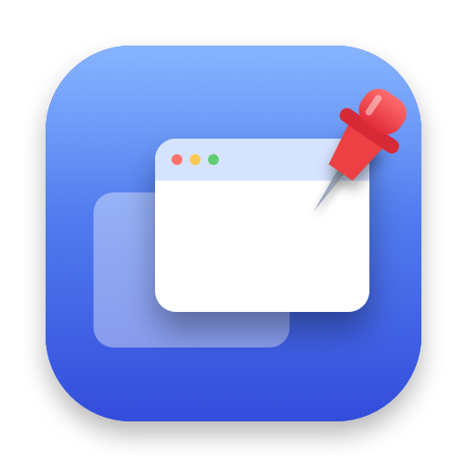

<p align="center"></p>

# PinTop — macOS 窗口悬浮 / 并排工具

让任意 App 的某个窗口始终显示在其他窗口之上（镜像悬浮），或把它摆到屏幕指定位置（并排布局）。
带主窗口和菜单栏图标的 App，也提供命令行用法；Swift 编写，不修改任何窗口内容。

## 最新版本：V0.2.1

| | 链接 |
|---|---|
| 下载 DMG（最新版） | **[PinTop.dmg](https://github.com/RainDayDream/PinTop/releases/latest/download/PinTop.dmg)** |
| 本版本说明 | [Release V0.2.1](https://github.com/RainDayDream/PinTop/releases/tag/V0.2.1) |
| 所有版本 | [Releases](https://github.com/RainDayDream/PinTop/releases) |

**当前可用功能**
- **镜像悬浮**：让某个窗口始终显示在其他窗口之上；被盖住时在最上层显示它的实时画面，点击即可继续操作。
- **悬浮范围**：当前桌面 / 所有桌面（含其他 App 的全屏桌面）/ **指定某个具体桌面**（自动识别你现有的所有桌面）。
- **悬浮窗口右上角「✕ 取消悬浮」浮标**，一键取消。
- **同时悬浮多个窗口**（可选），「正在悬浮」列表逐行显示、可单独取消，并可**拖动排序**或用下拉框设置每个窗口的悬浮层级顺序。
- **并排布局**：把窗口摆到屏幕靠右/左/上/下的指定大小，或**自定义位置和大小**（X、Y、宽、高，可读取窗口当前值再微调），可把其他窗口放进剩余区域，随时「恢复原位置」。在主窗口里它是独立于悬浮的一块，放在最下面并用分隔线隔开。
- **主窗口 + 菜单栏图钉** 两种入口，另提供**命令行**（`pintop`）。
- **主窗口可自由调整大小**，内容随窗口自适应，并记住上次的大小和位置。

## 安装

**一键安装（推荐）**：在「终端」里粘贴运行，自动下载最新版并安装到「应用程序」：

```bash
curl -fL --retry 3 -o /tmp/PinTop.dmg https://github.com/RainDayDream/PinTop/releases/latest/download/PinTop.dmg \
  && hdiutil attach /tmp/PinTop.dmg -nobrowse -quiet -mountpoint /tmp/PinTopVolume \
  && rm -rf /Applications/PinTop.app \
  && cp -R /tmp/PinTopVolume/PinTop.app /Applications/ ; \
  hdiutil detach /tmp/PinTopVolume -quiet ; rm -f /tmp/PinTop.dmg ; \
  open /Applications/PinTop.app
```

用 `curl` 下载的文件不带系统“隔离”标记，所以不会被 Gatekeeper 拦截。

**手动安装**：
1. 下载 **[PinTop.dmg（最新版）](https://github.com/RainDayDream/PinTop/releases/latest/download/PinTop.dmg)**，或到 [Releases 页面](https://github.com/RainDayDream/PinTop/releases) 选择版本；
2. 双击 DMG，把 **PinTop** 拖到 **Applications**；
3. 首次打开：在「应用程序」里**右键 PinTop → 打开**（本 App 未经苹果公证，浏览器下载的文件会被系统提示“无法验证开发者”）；
   或在终端运行 `xattr -dr com.apple.quarantine /Applications/PinTop.app` 后再打开。

**首次使用需授权**：在 系统设置 → 隐私与安全性 中给 **PinTop** 打开「辅助功能」和「屏幕录制」（授权屏幕录制后，完全退出并重新打开 PinTop）。
主窗口顶部会显示两项权限的状态。

**卸载**：退出 PinTop，把 `/Applications/PinTop.app` 移到废纸篓；可选：`tccutil reset All com.raindaydream.pintop` 清除授权记录。

> 只运行「应用程序」里的那一份 PinTop。DMG 里或 `build.noindex/` 里的同名 App 与它是同一个 Bundle ID，混着运行可能让授权状态错乱。

## 使用

打开 PinTop 会出现主窗口（屏幕顶部菜单栏的图钉图标是同样功能的快捷入口）：

1. **选择窗口**：在下拉框里选要操作的窗口，窗口不全时点「刷新」。
2. **镜像悬浮**：在范围下拉框里选在哪个桌面悬浮，点「开始镜像悬浮」：
   - **当前桌面**；**所有桌面（含全屏桌面）**；
   - **指定：桌面 N / 全屏：某 App**：PinTop 会识别你现在有哪些桌面（按 Mission Control 顺序），可以选其中任意一个，镜像只在那个桌面出现，切到别的桌面不显示。新增/删除桌面后点「刷新」更新列表。
   - 悬浮的窗口被别的窗口盖住时，会在最上层显示它的实时画面；点击画面即可继续操作。
   - 悬浮窗口的右上角有一个 **「✕ 取消悬浮」** 小浮标，点一下就取消该窗口的悬浮。
3. **正在悬浮**：每个悬浮的窗口一行，各有「取消」按钮；「全部取消」一键取消。
   默认一次只悬浮一个窗口，勾选「允许同时悬浮多个窗口」后可同时悬浮多个。
4. **设置悬浮顺序**：同时悬浮多个窗口时，有两种方式（效果一样）：
   - **拖动排序**：按住某一行左边的「☰」手柄，上下拖动到想要的位置再松开；
   - **下拉框**：每一行右侧的「第 N 层」下拉框（第 1 层 = 最顶），选择后该窗口移到那一层，其余窗口顺次让位。
   列表从上到下就是从顶层到底层。新悬浮的窗口默认放在最顶层，点击窗口不会改变顺序。调整后立即生效，不需要再点击窗口。
   - 两个悬浮窗口重叠时，层级更高的一个始终盖在另一个之上。
   - 如果悬浮窗口盖住了 PinTop 自己的窗口，把鼠标移到 PinTop 窗口上，它会自动浮到镜像之上，按钮照常点得到；鼠标移开后恢复普通层级。

**并排布局**（独立于悬浮，位于窗口最下方、用分隔线隔开）：调整上面选中窗口的位置和大小，不会让窗口悬浮。有两种模式：
- **靠屏幕一侧**：选位置（靠右/靠左/靠上/靠下）和大小（如 `35%` 或 `600`），点「摆放」。
- **自定义位置和大小**：填 **X、Y、宽、高** 四项，点「摆放」。
  - X、Y 是窗口左上角相对**屏幕可用区域**（菜单栏下方、Dock 之外）左上角的位置；每一项可以写像素（如 `100`），也可以写相对可用区域的百分比（如 `50%`）。
  - 「读取当前窗口」会把选中窗口现在的位置和大小填进来，再改一改即可；第一次切到自定义模式时会自动填入。
  - 填错会指出是哪一项（如“「宽」格式不对”）；宽高至少 50 像素；不允许把窗口整个放到屏幕外。
  - 窗口常有最小/最大尺寸限制，若实际结果与设置不同，会提示窗口实际的位置和大小。

「恢复原位置」可还原。

### 命令行

```bash
./pintop                      # 交互式：选窗口 → 选模式
./pintop list                 # 列出窗口ID
./pintop float <ID>           # 镜像悬浮（当前桌面）
./pintop float <ID> --all     # 镜像悬浮（所有桌面）
./pintop spaces               # 列出识别到的桌面（含全屏桌面）及序号
./pintop float <ID> --space 2 # 镜像悬浮，只出现在第 2 个桌面
./pintop dock <ID> --right 35%                       # 并排布局：靠右占 35%（--left/--top/--bottom，也可写像素）
./pintop dock <ID> --frame x,y,w,h                   # 自定义位置和大小（像素或百分比，相对屏幕可用区域左上角）
./pintop dock <ID> --right 35% --fit <ID2>,<ID3>     # 同时把其他窗口放进剩余区域
./pintop restore                                     # 恢复被 dock/fit 移动的窗口
```

悬浮模式按 Ctrl+C 退出，不遗留状态。命令行的授权对象是运行它的终端 App（辅助功能；镜像悬浮另需屏幕录制，授权后重启终端）。

## 镜像悬浮原理

macOS（SIP 开启）不允许第三方改变其他 App 窗口的层级：`AXRaise` 对后台 App 无效，`SLSOrderWindow` 被系统拒绝，
“前置 + 还焦点”会与被点击窗口互相抢占而闪动。因此采用镜像方案：

- 用 ScreenCaptureKit 捕获目标窗口，在最上层放一个无边框、不抢焦点的面板，与真窗口位置大小重合；
- 仅当目标窗口被其他窗口盖住时才显示镜像；未被盖住时隐藏，你操作的就是真窗口；
- 点击镜像：先激活真窗口，再把这次鼠标操作转发给它；之后打字走系统原生路径。拖动、滚动同样转发，可通过镜像移动/缩放窗口；
- 所有桌面模式：镜像面板出现在每个桌面，包括其他 App 的全屏桌面。真窗口在其他桌面/全屏桌面时，镜像是离开时刻的静态画面且只读
  （点击不转发，避免被系统带离当前桌面）；回到真窗口所在桌面后恢复实时并可操作；
- 指定桌面模式：识别桌面用到系统的只读接口，不移动任何窗口；只在目标桌面成为当前桌面时才显示镜像面板，面板自然落在那个桌面上；
- 悬浮顺序：每个悬浮窗口分配独立的窗口层级（层与层之间不交错），层级高的镜像一定盖住层级低的；
  某个悬浮窗口只有在被“非悬浮窗口”或“优先级更低的悬浮窗口”盖住时才显示镜像，被优先级更高的悬浮窗口盖住是正确的，不会显示；
- 推荐搭配：Dock 右键该 App →「选项 → 分配给 → 所有桌面」，这样在普通桌面里真窗口始终存在、可实时操作；全屏桌面则由镜像显示。

## 安全性

- 不注入代码、不改 SIP/系统设置、不读写窗口内容、不使用抢焦点的私有接口；
- 使用到的非公开符号都是只读的：`_AXUIElementGetWindow`（把 AX 窗口映射为窗口ID）、`CGSCopyManagedDisplaySpaces`（读取桌面列表）；
- 只有「并排布局」的 `--fit` 会改变其他 App 窗口的大小（默认不动），「恢复原位置」可还原。

## 已知限制

- 镜像画面有轻微延迟；输入法候选框、悬停提示等细节可能与真窗口略有差异；
- 其他 App 的全屏桌面里，悬浮窗口只能看、不能操作（系统不允许真窗口出现在那里）；
- 全屏窗口、固定大小窗口可能拒绝被调整（并排布局会提示）；
- App 为 ad-hoc 签名、未经苹果公证，见上面的“首次打开”。

## 从源码构建

需要 Xcode 命令行工具（`xcode-select --install`），macOS 14 及以上。

```bash
./build.sh      # 生成 ./pintop（命令行）、build.noindex/PinTop.app、build.noindex/PinTop.dmg
open build.noindex/PinTop.app
```

构建使用 ad-hoc 签名并固定指定要求（只认 Bundle ID `com.raindaydream.pintop`），重新构建后系统授权仍然有效。

代码结构：

```
Sources/Core.swift        核心：窗口列表、并排布局、镜像悬浮引擎
Sources/App/App.swift     App 入口：主窗口 + 菜单栏
Sources/CLI/main.swift    命令行入口
build.sh                  一键构建（命令行 + App + DMG）
```
